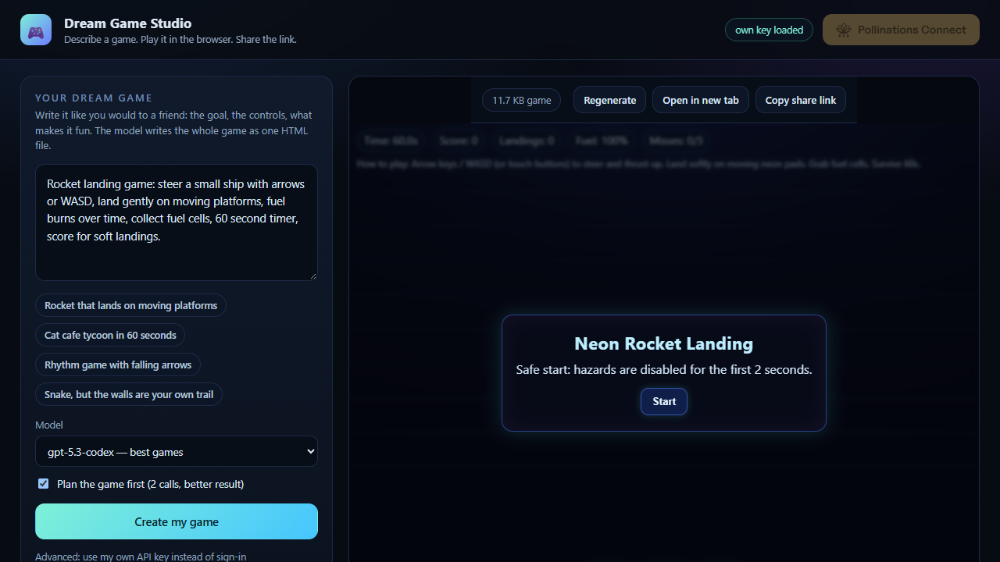

# Dream Game Studio

[](https://pollinations.ai/?ref=badge)



Describe a game in a sentence, watch it get written, and play it right there in
the page. One static HTML file, no build step, no server — the models do the work.

Built for the Pollinations community quest **#20021**.

## What happens when you press “Create my game”

1. **Planning (optional, on by default).** A cheap text model turns your sentence
   into a short game spec: player, goal, controls, hazards, win and lose state.
2. **Writing.** A code-capable model receives the brief plus the spec and returns
   one complete HTML document — markup, styles and game loop inlined.
3. **Playing.** The document runs inside a sandboxed `<iframe>` (`allow-scripts`,
   no same-origin), so generated code can never touch the page, your key or your
   data.
4. **Sharing.** “Copy share link” puts the brief and the model into the URL hash;
   opening that link restores the request, and one more click recreates the game.

## Paying with your own balance

No key, no app-hosted credits. The header carries the
[`polli-connect`](https://github.com/pollinations/pollinations/blob/main/BRING_YOUR_OWN_POLLEN.md)
element: visitors sign in with their Pollinations account and the page spends
from **their** balance, not the author's.

Prefer a key? Open *Advanced* and paste an `sk_…` key — it is kept in this
browser's `localStorage` and never sent anywhere except `gen.pollinations.ai`.

## Models

| Step | Default | Why |
|---|---|---|
| Planning | same model as writing | one setting, fewer surprises |
| Writing | `openai/gpt-5.3-codex` | the most reliable game code in the catalogue |
| Alternatives | `moonshotai/kimi-k3.1-pro`, `z-ai/glm-5.3-flash` | faster / cheaper |

All three are `paid_only: false`, so they work on a free or quest balance.

## Run it locally

```bash
git clone https://github.com/<you>/dream-game-studio
cd dream-game-studio
python -m http.server 8000
# open http://localhost:8000
```

Opening `index.html` straight from disk also works: the API answers with
`Access-Control-Allow-Origin: *`.

## Deploy (GitHub Pages, free)

1. Push the repository.
2. Settings → Pages → Source: *Deploy from a branch* → `main` / `root`.
3. The app is live at `https://<you>.github.io/dream-game-studio/`.

If you use the bundled `app-key` (public App Key), add that exact URL as a
redirect URI for the key at [enter.pollinations.ai](https://enter.pollinations.ai).
Without it, sign-in still works — you just do not earn referral credit.

## Design notes

- **The prompt is the product.** Every rule that made games playable lives in
  `CODE_SYSTEM` in `index.html`: a safe first two seconds, ramping difficulty,
  arrow keys *and* WASD, on-screen touch buttons, delta-time movement, a restart
  control. Removing those lines brings back instant deaths and unstable speed.
- **Two calls beat one.** Planning first costs a fraction of a cent and removes
  the “the model ignored half my idea” failure mode.
- **Sandboxing is not optional.** Generated code is untrusted by definition; the
  frame gets `allow-scripts` and nothing else.
- **Failures are normal.** Models occasionally return prose instead of HTML; the
  extractor strips fences and prose, and Regenerate usually fixes it.

## Privacy

The brief goes to Pollinations models so they can write the game. Do not paste
personal data, credentials or confidential client material. Nothing is stored on
a server: the page is static and keeps your key in `localStorage` only.

## License

MIT — see [LICENSE](LICENSE).
